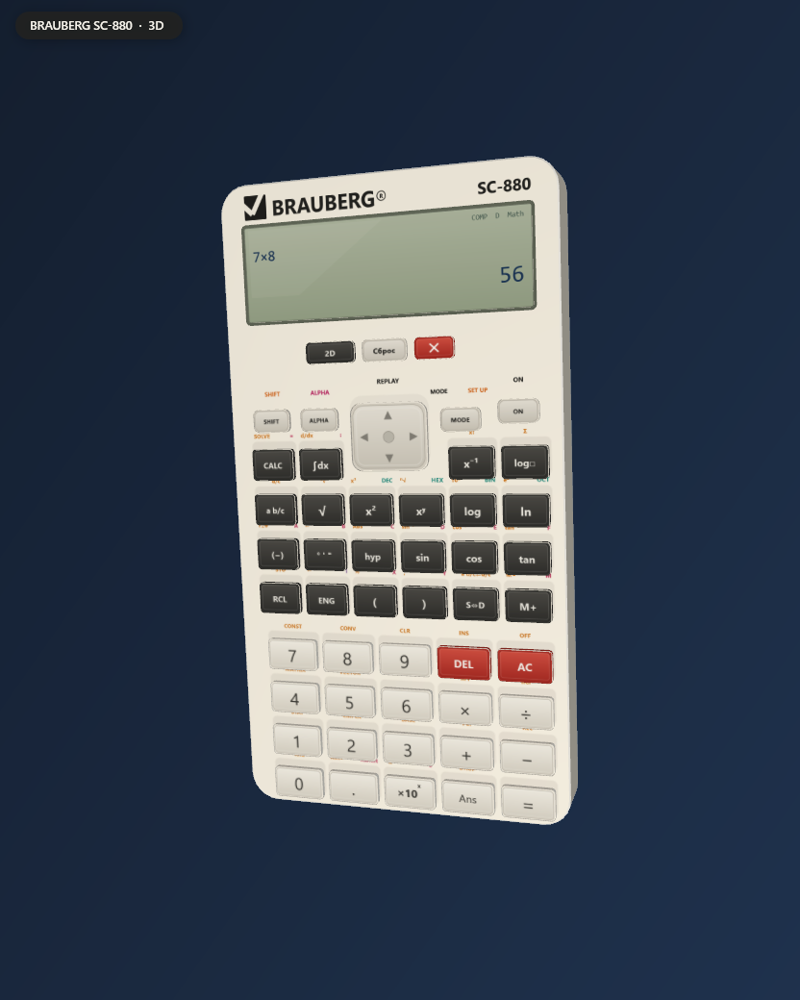
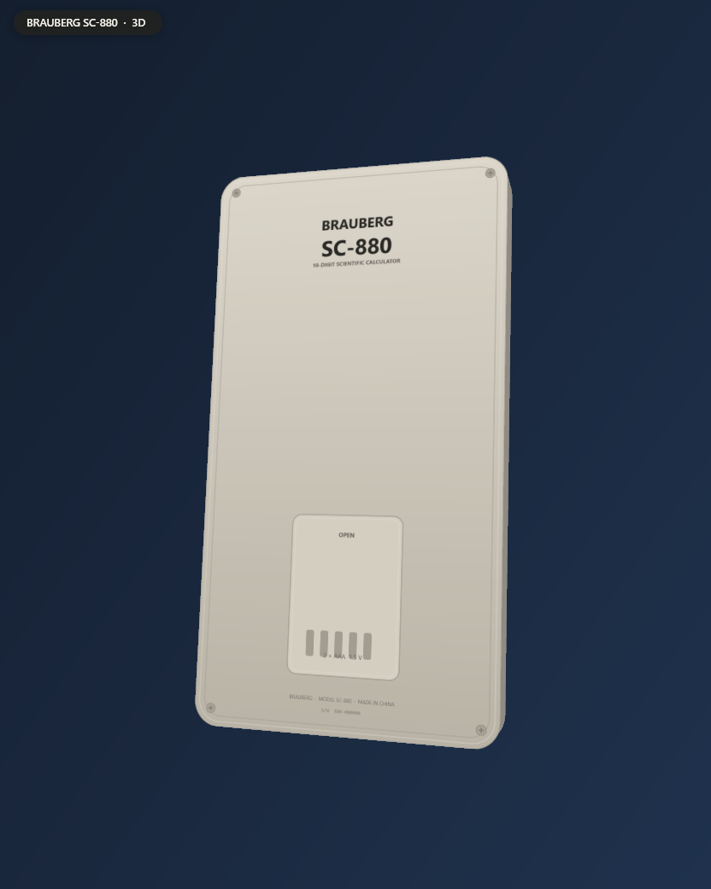

# Brauberg SC-880 — инженерный калькулятор для Windows

<p>
  
</p>

**Неофициальная реплика инженерного калькулятора Brauberg SC-880** с полноценным
3D-корпусом, прозрачным окном и живым интерфейсом. Написана на C# без сторонних
библиотек: WinForms для плоского вида и WPF `Viewport3D` для настоящей 3D-модели.

[](https://github.com/mirip666/brauberg-sc880/releases/latest)


[](https://github.com/mirip666/brauberg-sc880/actions/workflows/build.yml)

<p align="center">
  <a href="docs/screenshot.png"></a>
  <a href="docs/screenshot-3d.png"></a>
</p>
<p align="center"><em>Плоский интерфейс и объёмный корпус с прозрачным окном</em></p>

> Проект не связан с Brauberg. Название и логотип используются только для описания
> реплики устройства; права на товарные знаки принадлежат их владельцам.

## Скачать

Готовый файл: **[BraubergSC880.exe](https://github.com/mirip666/brauberg-sc880/releases/latest)**.

Установка не требуется: это один portable-exe для Windows. Нужен только
.NET Framework 4.x, который уже входит в Windows 10 и 11.

## Что умеет калькулятор

### Вычисления

- Базовые операции, степени, корни, проценты, факториал.
- Тригонометрия, обратные и гиперболические функции.
- Логарифмы, экспонента, инженерный формат `ENG`.
- Дроби и переключение `S⇔D`, градусы-минуты-секунды, `DRG▶`.
- Комплексные числа: арифметика, модуль, аргумент, сопряжение,
  полярная форма `r∠θ`.
- Перестановки, сочетания, НОД, случайные числа, физические константы.
- Численное решение уравнений, интеграл, производная, сумма `Σ`.

### Режимы

- **COMP** — обычные вычисления.
- **CMPLX** — комплексные числа.
- **STAT** — статистика одной и двух переменных, линейная регрессия, медиана.
- **BASE-N** — двоичная, восьмеричная, десятичная и шестнадцатеричная системы.
- **EQN** — линейные, квадратные и кубические уравнения.
- **MATRIX** — матрицы A/B/C: определитель, обратная, сложение, умножение.
- **VECTOR** — векторы: скалярное и векторное произведение, угол, длина.
- **TABLE** — таблицы значений.
- **VERIF** — проверка выражений и сравнений.

### 3D-вид

- Настоящая 3D-модель корпуса с клавиатурой и D-pad на WPF.
- Свободное вращение мышью со всех сторон, масштабирование колесом.
- Прозрачное окно: рабочий стол виден вокруг корпуса.
- ЖК-экран обновляется в реальном времени.
- Клавиши и D-pad на 3D-модели кликабельны.
- Кнопки **2D**, **Сброс** и **×** находятся на самом корпусе под экраном
  и вращаются вместе с калькулятором.
- Открытие: кнопка **3D** в шапке или `F4`. Возврат: **2D** или `F4`.
- Запуск сразу в 3D: `BraubergSC880.exe --3d` (также `/3d` или `-3d`).
- Справка `F1` открывается поверх 3D-окна, после закрытия управление возвращается.

<p align="center">
  <a href="docs/screenshot-3d-back.png"></a>
</p>
<p align="center"><em>Обратная сторона корпуса: батарейный отсек и шильдик</em></p>

### Интерфейс и удобство

- Русскоязычный интерфейс и встроенная справка.
- История вычислений с навигацией стрелками.
- Память `M`, `M+`, `M−`.
- Копирование результата в буфер обмена по `Ctrl+C`.
- Аккуратная отрисовка корпуса, клавиш и ЖК-экрана без сторонних компонентов.
- Один exe, без установщика и фоновых служб.

## Горячие клавиши

| Клавиши | Действие |
| --- | --- |
| `0–9`, `+ − * / ^ ( ) .` | Ввод выражения |
| `Enter` или `=` | Вычислить |
| `Backspace` | Удалить символ |
| `Esc` | Очистить |
| `←` / `→` | Перемещение курсора |
| `↑` / `↓` | История вычислений |
| `Ctrl+C` | Копировать результат |
| `F1` | Справка |
| `F2` | Выбор режима |
| `F3` | Настройки |
| `F4` | Переключение 2D / 3D |
| `p` | Число π |
| `i` | Мнимая единица |
| `a–f`, `x`, `y`, `m` | Переменные и ячейки памяти |

## Технологии

- C# 5, WinForms, GDI+.
- WPF `Viewport3D`, `PerspectiveCamera`, `MeshGeometry3D`.
- .NET Framework 4.x, сборка через `csc.exe`.
- GitHub Actions: сборка и 47 вычислительных тестов на `windows-latest`.

## Сборка

Из корня репозитория:

```powershell
powershell -NoProfile -ExecutionPolicy Bypass -File .\build.ps1
```

Готовый файл появится здесь:

```text
dist\BraubergSC880.exe
```

Скрипт собирает `AnyCPU`-приложение со встроенной иконкой и манифестом DPI.

## Тесты

```powershell
powershell -NoProfile -ExecutionPolicy Bypass -File .\build-tests.ps1
```

Ожидаемый результат:

```text
TOTAL: 47 passed, 0 failed
```

## Структура проекта

```text
brauberg-sc880/
├─ src/                 исходники (WinForms + WPF 3D)
├─ tests/               вычислительные тесты
├─ assets/              иконка и манифест
├─ tools/               генератор иконки
├─ docs/                скриншоты плоского и 3D-вида
├─ build.ps1            сборка exe
├─ build-tests.ps1      сборка и запуск тестов
└─ .github/workflows/   CI-сборка на GitHub Actions
```

## Участие в проекте

Проект открыт для улучшений: сообщения об ошибках, идеи, исправления и новые
функции приветствуются.

1. Сделайте fork репозитория.
2. Создайте ветку с понятным названием, например `fix/3d-rotation`.
3. Внесите изменения и запустите `build-tests.ps1`.
4. Откройте pull request с кратким описанием изменений.

Если нашли ошибку, создайте
[issue](https://github.com/mirip666/brauberg-sc880/issues) и приложите шаги
воспроизведения, версию Windows и скриншот, если он помогает.

## Лицензия

Код распространяется по лицензии **MIT**. Можно использовать, изменять,
распространять и встраивать в свои проекты; достаточно сохранить текст лицензии.
Подробности — в файле [LICENSE](LICENSE).
