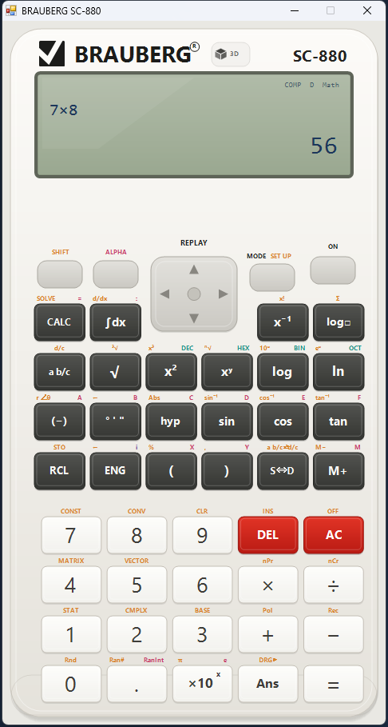
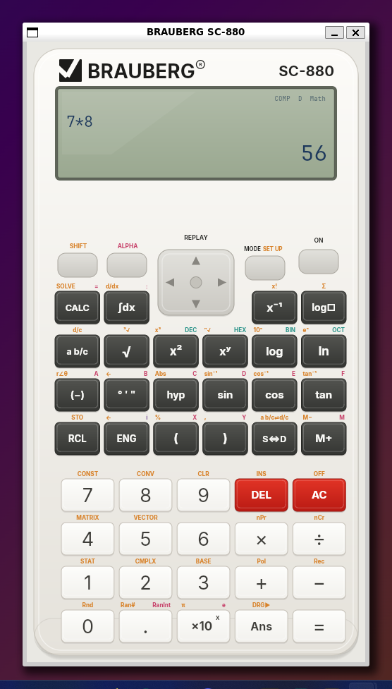

# Brauberg SC-880 — инженерный калькулятор для Windows и Linux

<p>
  
</p>

**Неофициальная реплика инженерного калькулятора Brauberg SC-880** с живым
интерфейсом, историей вычислений и всеми режимами оригинала. Windows-версия
написана на WinForms/WPF, Linux-версия — нативный порт на .NET 8 и Avalonia
(без Wine), с теми же вычислениями и оформлением.

[](https://github.com/mirip666/brauberg-sc880/releases/latest)


[](https://github.com/mirip666/brauberg-sc880/actions/workflows/build.yml)
[](https://github.com/mirip666/brauberg-sc880/actions/workflows/linux.yml)

<p align="center">
  <a href="docs/screenshot.png"></a>
  <a href="docs/screenshot-3d.png"></a>
  <a href="docs/screenshot-linux.png"></a>
</p>
<p align="center"><em>Плоский интерфейс, объёмный корпус (3D — Windows) и Linux-версия на Avalonia</em></p>

> Проект не связан с Brauberg. Название и логотип используются только для описания
> реплики устройства; права на товарные знаки принадлежат их владельцам.

## Скачать

### Windows

Готовый файл: **[BraubergSC880.exe](https://github.com/mirip666/brauberg-sc880/releases/latest)**.
Установка не требуется: это один portable-exe. Нужен только .NET Framework 4.x,
который уже входит в Windows 10 и 11. 3D-вид доступен в Windows-версии (`F4`).

### Linux

Нативная версия для x86_64, без Wine и без установленного .NET. Выберите формат
под свою систему:

| Система | Файл | Установка |
| --- | --- | --- |
| Debian, Ubuntu, Mint | `brauberg-sc880_1.1.0_amd64.deb` | `sudo apt install ./brauberg-sc880_1.1.0_amd64.deb` |
| Fedora, RHEL, openSUSE | `brauberg-sc880-1.1.0-1.x86_64.rpm` | `sudo dnf install ./brauberg-sc880-1.1.0-1.x86_64.rpm` |
| Arch, Manjaro, EndeavourOS | `brauberg-sc880-1.1.0-1-x86_64.pkg.tar.zst` | `sudo pacman -U ./brauberg-sc880-1.1.0-1-x86_64.pkg.tar.zst` |
| Любой дистрибутив | `brauberg-sc880-1.1.0-x86_64.AppImage` | `chmod +x`, затем запустить |
| Любой дистрибутив | `brauberg-sc880-1.1.0-linux-x64.tar.gz` | распаковать и запустить `./brauberg-sc880` |

После установки приложение появляется в меню как **BRAUBERG SC-880**.
Пакеты также лежат в артефактах сборки `linux` на GitHub Actions.

## Что умеет калькулятор

### Вычисления

- Базовые операции, степени, корни, проценты, факториал.
- Тригонометрия, обратные и гиперболические функции.
- Логарифмы, экспонента, инженерный формат `ENG`.
- Дроби и переключение `S⇔D`, градусы-минуты-секунды, `DRG▶`.
- Комплексные числа: арифметика, модуль, аргумент, сопряжение,
  полярная форма `r∠θ`.
- Перестановки, сочетания, НОД, случайные числа, физические константы.
- Численное решение уравнений, интеграл, производная, сумма `Σ`.

### Режимы

- **COMP** — обычные вычисления.
- **CMPLX** — комплексные числа.
- **STAT** — статистика одной и двух переменных, линейная регрессия, медиана.
- **BASE-N** — двоичная, восьмеричная, десятичная и шестнадцатеричная системы.
- **EQN** — линейные, квадратные и кубические уравнения.
- **MATRIX** — матрицы A/B/C: определитель, обратная, сложение, умножение.
- **VECTOR** — векторы: скалярное и векторное произведение, угол, длина.
- **TABLE** — таблицы значений.
- **VERIF** — проверка выражений и сравнений.

### 3D-вид (Windows)

- Настоящая 3D-модель корпуса с клавиатурой и D-pad на WPF.
- Свободное вращение мышью со всех сторон, масштабирование колесом.
- Прозрачное окно: рабочий стол виден вокруг корпуса.
- ЖК-экран обновляется в реальном времени.
- Клавиши и D-pad на 3D-модели кликабельны.
- Кнопки **2D**, **Сброс** и **×** находятся на самом корпусе под экраном
  и вращаются вместе с калькулятором.
- Открытие: кнопка **3D** в шапке или `F4`. Возврат: **2D** или `F4`.
- Запуск сразу в 3D: `BraubergSC880.exe --3d` (также `/3d` или `-3d`).
- Справка `F1` открывается поверх 3D-окна, после закрытия управление возвращается.

<p align="center">
  <a href="docs/screenshot-3d-back.png"></a>
</p>
<p align="center"><em>Обратная сторона корпуса: батарейный отсек и шильдик</em></p>

> В Linux-порте пока реализован плоский интерфейс; 3D-вид запланирован
> отдельным этапом. Все вычисления, режимы и диалоги уже доступны.

### Интерфейс и удобство

- Русскоязычный интерфейс и встроенная справка.
- История вычислений с навигацией стрелками.
- Память `M`, `M+`, `M−`.
- Копирование результата в буфер обмена по `Ctrl+C`.
- Аккуратная отрисовка корпуса, клавиш и ЖК-экрана.
- Windows: один exe без установщика. Linux: пакеты для основных дистрибутивов.

## Горячие клавиши

| Клавиши | Действие |
| --- | --- |
| `0–9`, `+ − * / ^ ( ) .` | Ввод выражения |
| `Enter` или `=` | Вычислить |
| `Backspace` | Удалить символ |
| `Esc` | Очистить |
| `←` / `→` | Перемещение курсора |
| `↑` / `↓` | История вычислений |
| `Ctrl+C` | Копировать результат |
| `F1` | Справка |
| `F2` | Выбор режима |
| `F3` | Настройки |
| `F4` | Переключение 2D / 3D (Windows) |
| `p` | Число π |
| `i` | Мнимая единица |
| `a–f`, `x`, `y`, `m` | Переменные и ячейки памяти |

## Технологии

- Windows: C# 5, WinForms, GDI+, WPF `Viewport3D`, .NET Framework 4.x.
- Linux: .NET 8, Avalonia 11, Skia, самодостаточная публикация `linux-x64`.
- Общее вычислительное ядро (`src/`) используется обеими версиями.
- GitHub Actions: Windows-сборка и 47 тестов, Linux-пакеты (deb, rpm, Arch,
  AppImage, tar.gz).

## Сборка

### Windows

Из корня репозитория:

```powershell
powershell -NoProfile -ExecutionPolicy Bypass -File .\build.ps1
```

Готовый файл появится здесь: `dist\BraubergSC880.exe`.

### Linux

Нужен .NET SDK 8:

```bash
dotnet run --project cross/Sc880.Tests/Sc880.Tests.csproj -c Release
dotnet publish cross/Sc880.Desktop/Sc880.Desktop.csproj \
  -c Release -r linux-x64 --self-contained true -o cross/publish/linux-x64
```

Пакеты собираются скриптами (нужны `dpkg-deb`, `rpmbuild` и `curl`):

```bash
export VERSION=1.1.0
export PUBLISH=cross/publish/linux-x64
export OUT=dist/linux

./cross/packaging/linux/build-tar.sh
./cross/packaging/linux/build-deb.sh
./cross/packaging/linux/build-rpm.sh
./cross/packaging/linux/build-appimage.sh
```

Arch-пакет: `cross/packaging/arch/PKGBUILD` (собирается через `makepkg` после
публикации tar.gz в релизе).

## Тесты

```powershell
powershell -NoProfile -ExecutionPolicy Bypass -File .\build-tests.ps1
```

Ожидаемый результат: `TOTAL: 47 passed, 0 failed`. Те же тесты запускаются
на Linux через `dotnet run --project cross/Sc880.Tests`.

## Структура проекта

```text
brauberg-sc880/
├─ src/                    общее ядро + WinForms/WPF-версия
├─ tests/                  вычислительные тесты (Windows)
├─ cross/                  нативный Linux/macOS-порт на Avalonia
│  ├─ Sc880.Core/          ядро без UI (ссылается на src/)
│  ├─ Sc880.Desktop/       интерфейс Avalonia
│  ├─ Sc880.Tests/         тесты на .NET 8
│  └─ packaging/           deb, rpm, Arch, AppImage, tar.gz
├─ assets/                 иконка и манифест
├─ tools/                  генератор иконки
├─ docs/                   скриншоты
├─ build.ps1               сборка Windows-exe
├─ build-tests.ps1         сборка и запуск тестов
└─ .github/workflows/      CI: Windows и Linux
```

## Участие в проекте

Проект открыт для улучшений: сообщения об ошибках, идеи, исправления и новые
функции приветствуются.

1. Сделайте fork репозитория.
2. Создайте ветку с понятным названием, например `fix/3d-rotation`.
3. Внесите изменения и запустите тесты.
4. Откройте pull request с кратким описанием изменений.

Если нашли ошибку, создайте
[issue](https://github.com/mirip666/brauberg-sc880/issues) и приложите шаги
воспроизведения, версию системы и скриншот, если он помогает.

## Лицензия

Код распространяется по лицензии **MIT**. Можно использовать, изменять,
распространять и встраивать в свои проекты; достаточно сохранить текст лицензии.
Подробности — в файле [LICENSE](LICENSE).
